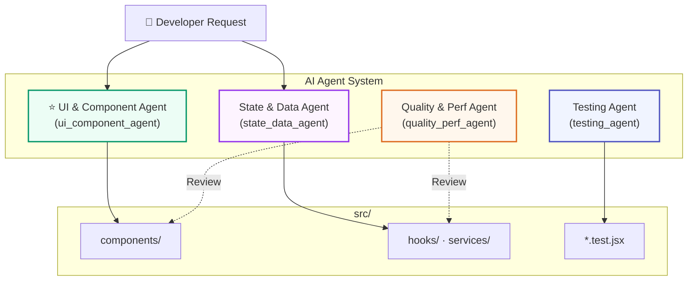

# AI Agent System — Frontend Project

4 specialized AI agents for the vacation rental marketplace frontend, tailored to the actual project stack (**Vite + React 18 + Tailwind CSS 3 + JSX**).

---

## Agent Architecture



---

## Agent Summary

| # | Agent | Name | Owns | Priority |
|---|---|---|---|---|
| 1 | ⭐ **UI & Component** | `ui_component_agent` | `components/` `pages/` `layouts/` `styles/` | **Highest** |
| 2 | **State & Data** | `state_data_agent` | `hooks/` `services/` `store/` `data/` `utils/` | High |
| 3 | **Quality & Perf** | `quality_perf_agent` | Reviews all `src/` files | Medium |
| 4 | **Testing** | `testing_agent` | `*.test.jsx` `test-utils/` | Medium |

---

## 1. ⭐ UI & Component Agent

> **Name**: `ui_component_agent` · **Role**: Senior React UI Engineer

| Aspect | Detail |
|---|---|
| **Purpose** | Build reusable React components with consistent Airbnb-inspired design |
| **Owns** | `src/components/` · `src/pages/` · `src/layouts/` · `src/App.jsx` · CSS files · `tailwind.config.js` |
| **Standards** | Tailwind CSS · Mobile-first · Semantic HTML · ARIA · < 200 lines per component |
| **Knows** | All 15 existing components, reference HTML in `reference/` directory |

### Current Components (15)
`AmenitiesModal` · `BookingWidget` · `Footer` · `HeroGallery` · `LightboxModal` · `ListingCalendar` · `ListingDetails` · `ListingHeader` · `ListingLocationHost` · `ListingReviews` · `ListingSubNav` · `MoreStaysNearby` · `Navbar` · `PhotoTourModal` · `ThingsToKnow`

---

## 2. State & Data Agent

> **Name**: `state_data_agent` · **Role**: Frontend Data Architect

| Aspect | Detail |
|---|---|
| **Purpose** | Manage all frontend data flow, keep business logic outside UI |
| **Owns** | `src/hooks/` · `src/services/` · `src/store/` · `src/data/` · `src/utils/` |
| **Standards** | Custom hooks · Mock APIs with delays · Local state first · Handle loading/error/empty |
| **Approach** | Presentational components + logic hooks · React Query when adopted |

---

## 3. Quality & Performance Agent

> **Name**: `quality_perf_agent` · **Role**: Code Quality & Performance Reviewer

| Aspect | Detail |
|---|---|
| **Purpose** | Review and optimize every change before completion |
| **Scope** | All `src/` files (read + refactor, no functional changes) |
| **Checks** | Re-renders · Accessibility · Semantic HTML · Responsive layout · Image optimization · Bundle size · Code duplication · Maintainability |
| **Output** | Findings tagged as `[CRITICAL]` · `[WARNING]` · `[INFO]` with concrete fixes |

---

## 4. Testing Agent

> **Name**: `testing_agent` · **Role**: Frontend Test Engineer

| Aspect | Detail |
|---|---|
| **Purpose** | Keep the page reliable with meaningful tests |
| **Owns** | `src/**/*.test.jsx` · `src/test-utils/` · `vitest.config.js` |
| **Tools** | Vitest + React Testing Library + @testing-library/user-event |
| **Focus** | User interactions · Rendering · Loading/error states · Accessibility queries |
| **Avoids** | Testing implementation details (internal state, method calls) |

---

## Shared Coding Standards

```
Language:       JSX (React 18) — TypeScript migration planned
Framework:      Vite + React + react-router-dom
Styling:        Tailwind CSS 3, mobile-first, no inline styles
Components:     Functional only, single responsibility, reusable
State:          Local first → Context → Zustand (if needed)
Accessibility:  Semantic HTML, keyboard nav, ARIA labels, color contrast
Performance:    Lazy loading, image optimization, memoization when beneficial
Code Quality:   ESLint, consistent naming, small focused files
```

---

## Usage Examples

### Invoke a single agent
```
"Use the ui_component_agent to refactor ListingDetails into smaller sub-components"
```

### Invoke multiple agents in sequence
```
1. ui_component_agent → build the component
2. quality_perf_agent → review for performance & accessibility
3. testing_agent → write tests for the new component
```

### Invoke for a code review
```
"Use quality_perf_agent to review all components for accessibility issues"
```
